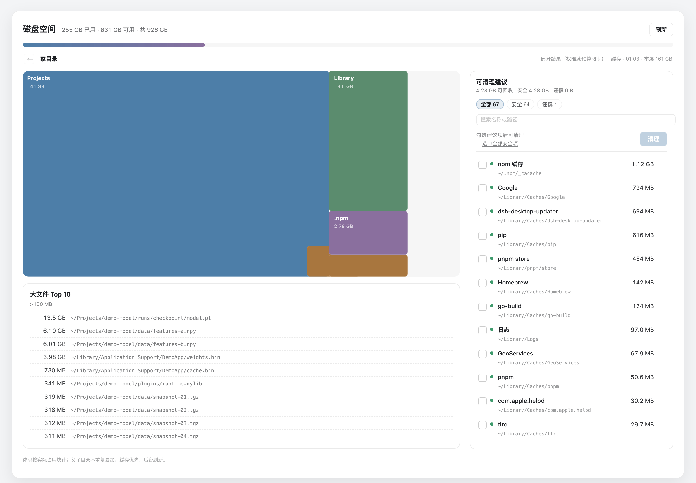
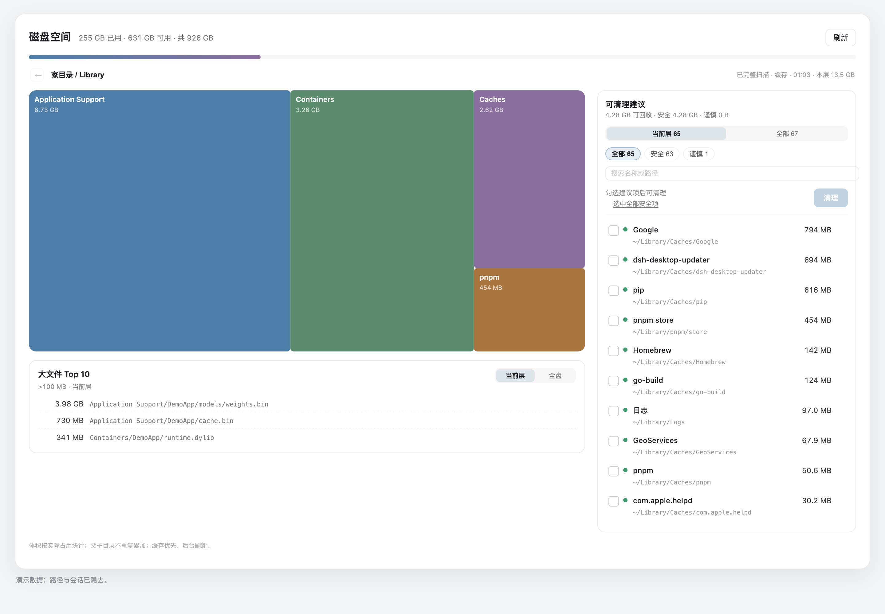
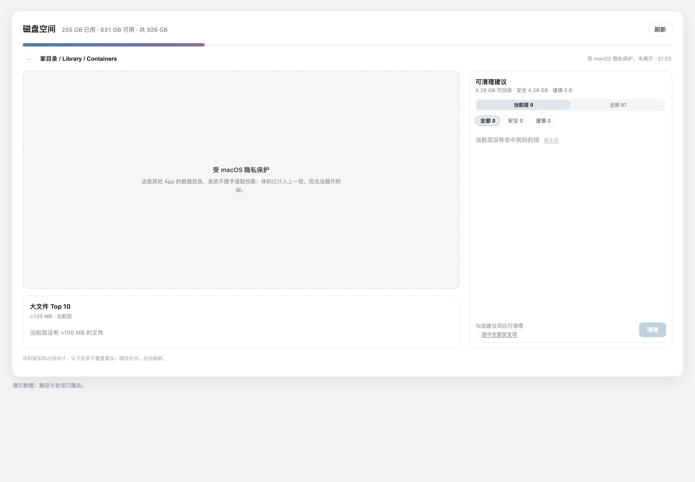

# dsh-disk-ops

DSH Desktop 的本机磁盘空间插件：**一个面板回答三个问题** —— 空间去哪了、能清什么、清了安全吗。命令与 agent 工具是辅助入口。



> 截图使用演示数据；路径与会话已隐去。

- 左侧栏「磁盘空间」图标 → 全宽主面板；兜底入口：设置 → 磁盘空间。
- treemap 面积即占用；**悬浮看路径与占比，单击下钻，双击在 Finder 中显示**；面包屑或 `Esc` 返回。
- 左侧树图下方接大文件 Top 10；右侧建议列通高对齐，按 `安全 / 谨慎` 过滤，支持「选中全部安全项」；清理走 **计划 → 内联确认 → 移入废纸篓**，默认可放回。
- 缓存优先、后台刷新：打开即有画面，过期数据在后台更新，不空屏等 `du`。
- 数据联动：建议、树图、大文件共享同一个当前位置，而不是三个互不相干的列表。
- 只读权限：不申请全盘访问、永不 `sudo`；`~/Library/Containers` 等 TCC 目录显示体积但**不展开**，不会弹系统授权框。

## 安装（本机）

```bash
cd disk-ops
node scripts/build-client.mjs      # 可选：只重建 client
node scripts/install.mjs --dist    # 生成 dist/<hash>/ 与 cordis.patch.yml
```

然后用 DSH 的插件管理器把本目录作为本地 bundle 安装：

```text
plugin_manager install_bundle target="$PWD"
```

已安装同版本时先 `remove_bundle` 再 `install_bundle`；Client 改动需要刷新一次页面。
发布版（npm registry）安装：

```text
plugin_manager install_bundle target="dsh-disk-ops"
plugin_manager install_bundle target="dsh-disk-ops@0.2.0" registry="https://registry.npmjs.org"
```

发现入口是**社区目录 / 插件市场索引**：把 `market/index.json` 的 HTTPS 地址加到 Settings → Plugin Market 即可搜索安装；更常见的做法是向 [awesome-dsh-plugin](https://github.com/awesome-dsh-plugin/awesome-dsh-plugin) 提交一个 YAML（dsh-market 与 dshmarket.com 都从它生成）。发布流程、检查清单与索引格式见 [PUBLISH.md](PUBLISH.md)。


## 使用

```text
/disk scan [path] [--refresh]      # 一层目录 + 建议
/disk big [--min 100MB]            # 大文件 Top
/disk status                        # 容量与数据目录
/disk rules                         # 规则表
/disk clean                         # 生成清理计划（不删除）
/disk clean --confirm <token>       # 执行该计划（移入废纸篓）
/disk trash-empty --confirm <count> # 永久清空废纸篓，需输入当前条目数
dsh-disk <同上>                     # 不带 DSH 的 CLI
```

agent 侧：`disk_scan`（只读）、`disk_clean`（`plan` → `commit`，commit 会弹用户确认）。

## 面板交互

| 操作 | 结果 | 反馈 |
|---|---|---|
| 悬浮色块 | 路径、大小、占本层比例；有规则时给「可清理」或「含可清理 n 项」 | 跟随光标的浮层 |
| 单击目录 | 下钻一层 | 面包屑增长；扫描中旧图变暗并提示；状态栏显示「本层 X GB」 |
| 双击目录/文件 | `open -R` 在 Finder 中显示 | — |
| `Esc` / ← / 面包屑 | 返回上层（`Esc` 先清搜索词） | 返回按钮在根层禁用 |
| 悬浮建议行 | 高亮它在当前层的所属色块 | 树图与列表像同一块数据 |
| 点击建议行 | 勾选/取消 | 行高亮、底部合计随选更新 |
| 建议行「↗」 | 跳到该项父目录并高亮 | 深层缓存也能一眼定位 |
| 范围：当前层 / 全部 | 建议只显示当前目录下的项 | 切层自动回到「当前层」 |
| 搜索框（按 `/` 聚焦） | 按名称/路径过滤建议 | 选中项被过滤掉时提示「n 项不在当前筛选」 |
| 「选中全部安全项」 | 一次选中当前范围里所有 `safe` 可删项 | 显示 `n 项 · X GB` |
| 清理 | 只生成计划，不删除 | 内联卡片：条目数、总大小、10 分钟有效 |
| 确认 | 逐条复核 inode/size/mtime 后移入废纸篓 | 结果提示；审计追加 |
| 刷新 | `refresh=1` 重扫当前层 | `更新中…`，旧图保留 |
| 大文件：当前层 / 全盘 | 只列当前目录下或全家的 >100MB 文件 | 相对路径 + 「定位 / 显示」 |

建议范围、搜索与「定位」把三个区域连成一份数据：

- 悬浮建议 → 当前层对应色块描边；悬浮色块 → 「含可清理 63 项 · 3.16 GB」。
- 建议列表默认「当前层」，切到「全部」才回到全局规则表；切层自动回到当前层。
- 大文件在树图正下方，默认「当前层」，可切「全盘」；「定位」跳到文件父目录并高亮该文件。
- 选中项若被范围/搜索过滤掉，动作条会提示「（n 项不在当前筛选）」，避免误清看不见的项。

联动视图（下钻 Library：建议与「大文件」都切到当前层）：



对齐后的主视图：


隐私目录不展开：



## 数据与规则

```text
$DSH_HOME/disk-ops/
├── rules.json      # 可选：rules / ignore / neverDelete
├── audit.ndjson    # 追加写，5MB 轮转 ×3
└── cache/          # 每层扫描缓存，24h；过期也先展示，再后台刷新
```

`rules.json` 示例：

```json
{
  "ignore": ["~/Library/Caches/keep-me"],
  "neverDelete": ["~/Development/precious"],
  "rules": [
    {
      "id": "my-builds",
      "category": "自建产物",
      "kind": "prefix",
      "path": "~/src/build",
      "safety": "probably",
      "action": "trash"
    }
  ]
}
```

`kind`: `prefix`（目录及其子孙）、`children`（仅直接子项）、`ext`（按扩展名，配 `dirs`/`exts`/`minAgeDays`）。
`safety`: `safe | probably | risky | irreversible`；`action`: `trash | report | trash-empty`。

## 安全模型

- 只删家目录内、规则命中、非保护路径；路径先规范化再 `realpath`，越界即拒。
- 计划不可变、10 分钟过期，含 dev/inode/mtime/size；执行前逐条重新校验。
- 删除默认 `osascript` 调 Finder 移到废纸篓（保留「放回原处」），失败回退 `mv ~/.Trash`。
- 永久删除只有 `trash-empty`，必须输入当前条目数。
- 不做一键全清，不 sudo，不申请 FDA；TCC 目录（Containers / Group Containers / Mail / Safari）只统计、不展开。
- 审计 `audit.ndjson` 记录时间/原路径/大小/动作/落点/批次。

## 开发

```bash
node --test tests/*.test.mjs
node scripts/build-client.mjs    # client bundle（模板 + 面板 + 共享纯函数）
node scripts/install.mjs --dist  # 重建 dist/<hash> 并更新 patch
```

Host 代码改动需要重装 bundle（ESM 缓存）；Client 代码改动重装后刷新页面。
`scripts/install.mjs` 用内容哈希生成 `dist/<rev>/`，避免 `file://` URL 不变导致旧模块被缓存。

## 已知限制

- 体积按实际占用块（`du`）计；APFS 克隆共享块会重复计，不做克隆去重。
- 无全盘访问时 `~/Library` 内部分目录不可读，报告会标「部分结果」。
- 首次扫描未缓存的深层目录仍可能花数秒（预算 8s，超时标 partial）。
- `osascript` 首次使用可能触发「控制 Finder」的自动化授权；拒绝后自动回退 `mv`。

MIT。设计理由与取舍见 [DESIGN.md](DESIGN.md)。
